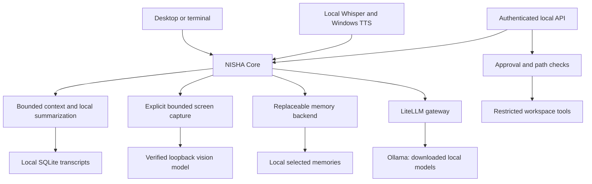

# Architecture decisions

NISHA owns identity, personality, conversation orchestration, memory policy and permissions.
Voice and desktop are optional clients of the same core. Generic model access is delegated
to a dedicated LiteLLM process. Both model services bind to localhost.

Screen analysis is opt-in per request. Captured pixels are resized and sent only to the
configured loopback Ollama vision model; they are not saved to disk by the screen service.
The Windows UI Automation adapter remains the preferred control path because it targets
named accessible controls rather than guessed screen coordinates.

1. **Preserve the prototype outside the active application.** Old UI/voice/agent source and
   data remain under `legacy/prototype`. Active code has no imports from that location.
   This avoids carrying unsafe command routing into the new foundation.
   The original dashboard and teal orb presentation are preserved in `nisha/ui`, with
   typed input and microphone events connected to the new local core.
2. **Use native Windows services first.** Existing Python and Ollama work. Docker is not
   installed in the inspected environment; installing it is unnecessary for this milestone.
   Native audio/Qt integration remains straightforward, while the gateway restarts separately.
3. **Use a dedicated LiteLLM gateway.** NISHA's adapter uses an OpenAI-compatible HTTP stream;
   provider SDKs and routing infrastructure stay outside the core. Model names, residency,
   limits and gateway configuration share one configuration source. No implicit cloud fallback.
4. **Keep NISHA's base conversation local permanently.** Optional OpenAI, Gemini and Claude
   workers use a separate native HTTP adapter with credentials in Windows Credential Manager.
   The desktop previews the exact standalone task and consumes a one-use, expiring approval.
   No base transcript, preferences, files, memory or summary is attached. Results return to
   local history and optionally a teacher review queue. Explicit acceptance adds them to
   the local knowledge index as unverified reference material.
   OpenAI response storage is disabled in each request; provider retention still depends on
   account policy. The original gateway task extension remains disabled. No provider is yet
   connected on this PC, and real paid provider calls were not made during verification.
5. **Use explicit memory and SQLite FTS5 first.** This is a small, durable backend using
   mature storage/search infrastructure. It exposes a `MemoryBackend` interface so local
   vector retrieval or an Odysseus adapter can replace it without replacing NISHA.
   This first stage does not claim semantic matching or episodic extraction.
6. **Separate history from permanent selected memories.** Only explicit selections become
   memories. Inactive history and task results have a configurable retention period. Context
   construction limits input size, keeps complete recent pairs and summarizes locally.
   A summary cursor advances only after a successful bounded summary; source history remains
   available until retention expires. A huge historical exchange can block summary batching;
   bounded recent context still works, with the original transcript retained.
7. **Dispatch real actions before conversational generation.** The active
   registry provides list/read/delete within one workspace. Approval is tied to a specific
   file and content digest, expires, and cannot be replayed. Website and installed-app
   commands invoke native adapters. Local generation produces text, Word and source files;
   the adapters open actual editors. Gmail drafts are local, tied to an exact digest and
   one-use approval, and sent through TLS SMTP only after approval. The Gmail app password
   lives in Windows Credential Manager. No unrestricted shell capability is exposed.
8. **Use local wake-word listening in the desktop.** Local Whisper uses cached weights only.
   Large-v3 on CUDA and local Silero VAD recognize bounded utterances and wake variants.
   Capture and transcription run separately so a wake phrase does not lose the next command.
   Background speech is discarded before reaching Core. Conversation stays awake until sleep
   or mute; a bounded follow-up interval remains configurable. Mute invalidates pending
   transcription, closes capture and requires a
   new wake word after unmuting. Explicit trusted wakes restore the window and start a new
   local session before any combined command; non-wake follow-ups stay in that session.
   Close hides to a system-tray resident and resets the follow-up gate without stopping
   capture. Mute and explicit Quit remain separate. A local lock/socket prevents duplicate
   desktop listeners; reopening a launcher starts a fresh visible chat in the resident. Windows login
   startup runs hidden, with a tray opt-out that subsequent launches respect.
   During thinking, wake-only capture can interrupt generation and queue a new-session
   command after the current operation completes. Session-bound Qt callbacks keep old
   replies out of the new chat. Already dispatched actions are allowed to finish.
   During spoken output, capture accepts only stop/dismiss controls in overlapping
   two-second windows every half second. Local ASR uses a one-beam control pass; matching
   recognized reply fragments are removed before exact control detection. Speaker audio
   cannot dispatch PC actions or wake a new session. Output transitions invalidate queued
   audio, so late speaker decoding cannot become a follow-up. Stop keeps the conversation;
   close/hide cancels speech and returns to background wake listening. Acoustic AEC remains pending.
   Manual opening starts a fresh visible session; switching models does not clear context.
   System-default mode follows the Windows capture endpoint, using one isolated worker
   and reopening when its identity changes. Optional priority selection monitors headset,
   USB and webcam input in separate helper processes.
   Signal quality, speech detection and ASR confidence affect selection. A failed native
   driver cannot freeze the UI or healthy capture helpers. Healthy workers remain warm
   between turns; mute closes capture. Windows speech uses pyttsx3 with a cancellable
   external event loop, purging native SAPI on its owning thread when interrupted.
   Speech and local language models share GPU memory;
   configuration and model residency determine latency. ASR uses a separate local process
   with bounded loading/inference and cancellation; uncertain wake/command confidence is
   evaluated separately. Explicit voice enrollment stores reviewed audio/transcript pairs.
   Its small personal MFCC/DTW wake model is trained/calibrated/tested on disjoint clips and
   activated only after held-out checks pass. It detects standalone wakes on CPU in the
   capture path independently of ASR; command transcription still uses cached Whisper.
   Arbitrary new requests during output and a general-purpose streaming wake model remain future work.
   The terminal voice client retains push-to-talk.
9. **Learn bounded preferences and retrieve local references.** Direct user feedback updates
   allowlisted response length, focus, wording, format and language preferences in SQLite.
   The style policy is constructed from validated enum values, not arbitrary imported text.
   Brief replies use a 384-token initial ceiling while the prompt still requests under
   60 words; detail requests override style for one turn. A genuine length stop continues
   through the installed Ollama templates' final-assistant prefill, keeping exact text
   boundaries and original instructions. Long output retains its beginning/latest ending
   in the bounded context while the application accumulates the full result. Eight segments
   and no-progress detection bound loops; interruption prevents subsequent requests.
   Structured drafts retry as a whole JSON object with more room, never splice partial
   JSON. Only completed results enter history or artifact/draft storage. Transport failures
   and content-filter refusals remain distinct errors. Context preceding an explicit writing
   request is retained and routed to the writing workflow. Imported
   files and pasted text are bounded, chunked and indexed in FTS5 with source metadata.
   Model output is an unverified source, never a learned instruction or automatic action.
   Weight training is not implemented; the user chose local searchable knowledge first.
   A local contextual bandit now learns reply presentation from explicit helpful/unhelpful
   ratings using Beta-Bernoulli Thompson sampling. It operates on generated informational
   and casual replies; actions and permissions remain outside the policy. Unrated replies earn no reward.
   Reviewed conversational teacher examples provide bounded style priors and token-budgeted
   demonstrations. They are excluded from factual retrieval and never become real user history.
   Expired raw decisions become anonymous aggregate reward counts. Reviewed exact-prompt
   teacher comparisons can be exported for later preference training; no weight trainer runs.
   See [reinforcement learning](reinforcement-learning.md) for controls and retention.
10. **Render visuals beside the conversation.** A separate translucent Qt tool window anchors
   to the right-middle of the main window. Public-topic lookup and image loading run in
   background jobs. Epochs reject stale results after navigation, new turns and dismissal.
   Personal-reference queries and queries with local knowledge matches suppress public lookup.
   Local/generated assets are preferred. Qt Multimedia handles manually started muted video.
   Wikimedia image/video adapters are present; Openverse provides a working image fallback
   when this network rejects Wikimedia. No local media generation model is installed.
11. **Connect explicit devices and projects locally.** A validated `connections.json`
   registry stores device endpoints, project paths and declarative routine steps. Device
   credentials stay in Windows Credential Manager. HTTP controls are distinct from GET
   health/state checks; receipts distinguish accepted requests from verified resulting
   states. Cached last-success times persist locally; background Qt jobs poll configured
   endpoints without blocking capture or UI. Camera snapshots refresh in memory, clear on
   failure and recover; streams use the existing muted Qt media panel. Configuration and
   actual physical compatibility are separate: no hardware endpoints are preconfigured.
12. **Prepare bounded artifacts and selected communication.** Presentation preparation
   reads explicitly selected project files, copies originals to a new workspace bundle,
   generates notes locally and reports missing evidence. Routines run only saved typed
   actions and stop on failure; no model-generated shell is allowed. User-requested Gmail
   inbox access uses read-only IMAP/PEEK; only a selected session-scoped message supplies
   a reply recipient/thread. Sending retains exact content-bound one-use approval. Research
   sends only a configured public query to a SearXNG JSON endpoint; private requirements
   and search snippets are compared by the local model with source URLs. Browser search
   is available when no search endpoint is configured.
   Email artifacts request a required subject/body JSON schema through the local gateway;
   the installed Ollama adapter maps it to constrained decoding. Truncated completions
   fail before an artifact/draft is accepted. Contract tests and real local generation
   verify this rather than relying only on a prompt asking for JSON.

The localhost services assume a trusted single-user Windows account. File approvals and
authentication are application boundaries, not an OS sandbox against another process
running as the same user. Selected memory and transcripts are ordinary local files and
should be protected with Windows account/storage controls as appropriate.

## Odysseus investigation

The supplied `odysseusai.dev` site identifies itself as an independent guide. The upstream
project is [odysseus-dev/odysseus](https://github.com/odysseus-dev/odysseus). Its README
documents native/Docker deployment and agents, tools, MCP, memory and research. Upstream
API-token source includes scoped memory access, but advertised features do not establish
a stable embeddable SDK or guarantee that a research job obeys NISHA's privacy policy.

Odysseus is not installed or integrated in this milestone. Before delegating real tasks:
pin a tested upstream revision, run it against local Ollama, verify authenticated API
contracts and cancellation, and prove that delegated tools cannot bypass NISHA approvals.
Keep the integration in a separate adapter. Review upstream AGPL obligations if distribution
or modification becomes part of the project.

## Documentation consulted

- [LiteLLM Ollama integration](https://docs.litellm.ai/docs/providers/ollama)
- [LiteLLM gateway configuration](https://docs.litellm.ai/docs/proxy/configs)
- [LiteLLM reliability and fallback behavior](https://docs.litellm.ai/docs/proxy/reliability)
- [Ollama Windows integration](https://docs.ollama.com/windows)
- [Ollama cloud controls](https://docs.ollama.com/faq#how-do-i-disable-ollama-cloud-features)
- [Odysseus upstream](https://github.com/odysseus-dev/odysseus)
- [Sounddevice input streams](https://python-sounddevice.readthedocs.io/en/latest/api/streams.html)
- [Faster Whisper local transcription and VAD](https://github.com/SYSTRAN/faster-whisper)
- [Large-v3 speech weights](https://huggingface.co/Systran/faster-whisper-large-v3)
- [Google app passwords](https://support.google.com/accounts/answer/185833)
- [OpenAI Responses API](https://developers.openai.com/api/docs/guides/migrate-to-responses)
- [OpenAI data controls](https://developers.openai.com/api/docs/guides/your-data)
- [Gemini text generation](https://ai.google.dev/gemini-api/docs/text-generation)
- [Claude Messages API](https://platform.claude.com/docs/en/api/messages/create)
- [Openverse media metadata](https://docs.openverse.org/meta/media_properties/api.html)
- [Qt media player](https://doc.qt.io/qtforpython-6.8/PySide6/QtMultimedia/QMediaPlayer.html)
- [Gmail IMAP and SMTP](https://developers.google.com/workspace/gmail/imap/imap-smtp)
- [Python IMAP client](https://docs.python.org/3/library/imaplib.html)
- [SearXNG search API](https://docs.searxng.org/dev/search_api.html)
- [Ollama structured outputs](https://ollama.com/blog/structured-outputs)
- [Qt system tray](https://doc.qt.io/qtforpython-6/PySide6/QtWidgets/QSystemTrayIcon.html)
- [Qt local sockets](https://doc.qt.io/qt-6/qlocalsocket.html)

